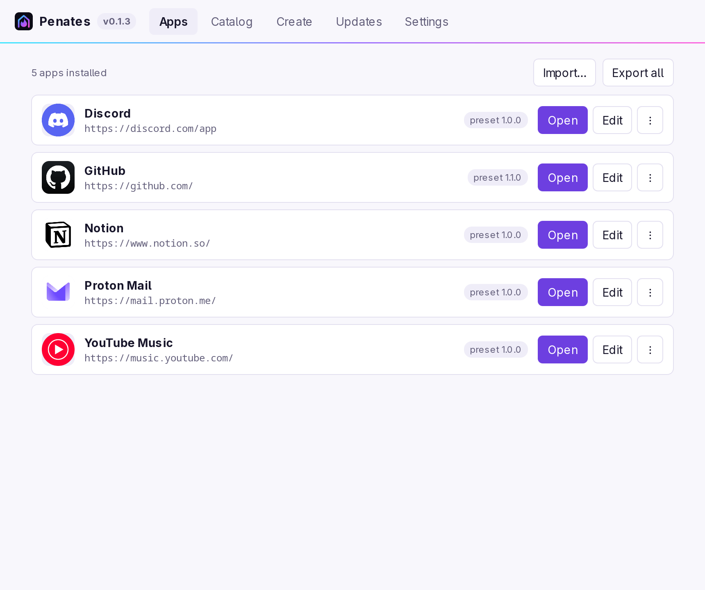
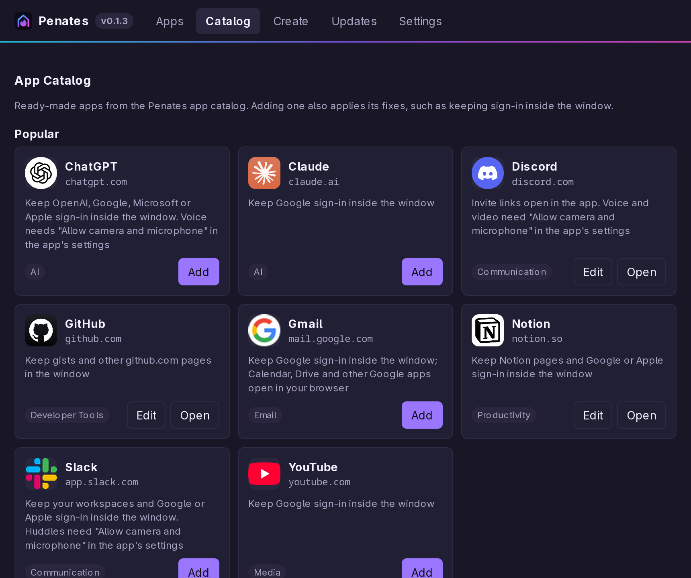
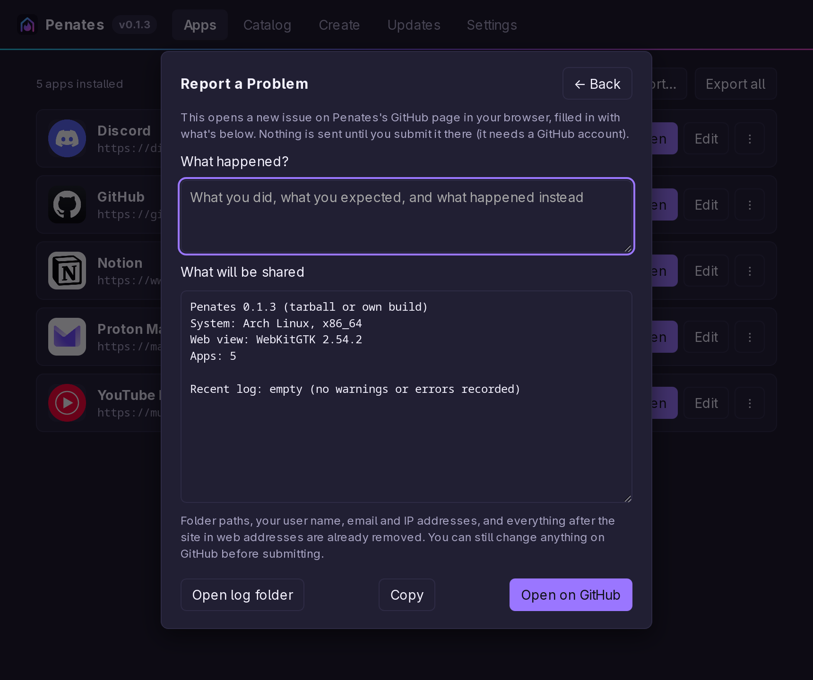

<p align="center"></p>

Turn any website or web app into a desktop app with its own window, icon, taskbar entry, tray icon and
separate login. Named after the Roman household gods: every site gets a home of its own.
Built with Rust and [Tauri 2](https://v2.tauri.app/), with a command line tool and a desktop manager.

**[getpenates.com](https://getpenates.com)**: the website, with the docs and a clickable demo of the manager.

**[Download the latest release](https://github.com/Natetronn/penates/releases/latest)**:
on Arch from the AUR, `paru -S penates-bin` (or `yay`, or `makepkg -si`); elsewhere the AppImage, `.deb` or `.rpm`; Windows installer; macOS `.dmg`. Every way, including building from git: [Getting Started](https://getpenates.com/getting-started/).

<p align="center"></p>

> **Status: 0.1.3.** Verified by hand on Linux (KDE Plasma, Wayland). Windows and macOS are built, launched
> through their launchers and smoke-tested in CI on every push. See [docs/STATUS.md](docs/STATUS.md) for exactly what is verified.

## What It Does
- **One command or a few clicks:** `penates create github.com` finds the site's name and icon (PWA manifest, apple-touch, favicon) and adds it to your application menu.
- **A real app window per site:** own taskbar entry and icon, separate cookies and storage per app, single-window mode, optional system tray icon (color or grayscale), and it can start as a window, minimized or only in the tray.
- **Per-app options:** window size, zoom, maximized/fullscreen/frameless, always on top, user agent, extra in-app hosts, custom CSS/JS, devtools, notification and camera/microphone permissions.
- **App Catalog:** add known sites (GitHub, Notion, Discord, Proton Mail, YouTube and more) in one click from the **Catalog** tab, with Popular picks, categories and search, and small fixes such as in-app sign-in from the shared [penates-apps](https://github.com/Natetronn/penates-apps) catalog. Add catalogs of your own (a file or an address) alongside it, or use only yours.
- **Smart links:** links to other sites open in your browser; same-site popups (sign-in flows) stay in the app; downloads go to your Downloads folder.
- **Browser keys without a browser:** Alt+←/→ or the mouse's side buttons go back and forward, F5 or Ctrl+R reloads, Alt+Home goes to the app's start page, and F1 or Ctrl+/ lists these keys.
- **A toolbar** per app (turn it off under Edit): back, forward, reload (stop while a page loads), start page, the page's address, the key list and Open in browser, in each site's own color, Penates's, or one you pick.
- **Share and back up:** export one app or all of them to a `.penates` file and import it elsewhere; logins are never included. Propose an app's fixes for the shared catalog from its ⋮ menu. Exports go to Downloads, or a folder you choose in Settings. See [docs/SHARING.md](docs/SHARING.md).
- **Housekeeping:** clear cache (keeps you signed in) or clear cookies and data, update checks with versioned presets, icons from a file or URL.
- **Themeable manager:** light/dark/system, six accents, four looks, all from plain CSS tokens.
- **Report a problem:** Penates keeps a small log of its own warnings and errors on your computer. **Report a problem** (in About and Settings, or `penates report`) shows the version, system and recent log lines with personal details removed, then opens a GitHub issue filled in with them; nothing is sent until you submit it.

## Screenshots
| Your Apps (Light) | App Catalog |
|---|---|
|  |  |
| **Edit an App** | **Settings** |
|  |  |
| **About** | **Report a Problem** |
|  |  |

## Install
**Arch Linux and relatives (CachyOS, EndeavourOS, Manjaro…), from the AUR:** `penates-bin` is the prebuilt release
(recommended, installs in seconds); `penates` builds from source (a few minutes). The two replace each other.

```sh
paru -S penates-bin                 # or: yay -S penates-bin; updates come with paru -Syu / yay -Syu

# without an AUR helper (pacman installs what makepkg builds; update with: git pull && makepkg -si)
sudo pacman -S --needed git base-devel
git clone https://aur.archlinux.org/penates-bin.git && cd penates-bin
makepkg -si
```

Each release also has an Arch package for `sudo pacman -U` (no automatic updates), and for other distributions an
AppImage, `.deb` and `.rpm` that update themselves. Windows and macOS (14 or later) installers are on the
[releases page](https://github.com/Natetronn/penates/releases/latest).

**First launch on macOS and Windows:** the installers are not signed with an Apple or Microsoft certificate yet.
On macOS, open the app once, then allow it under System Settings → Privacy & Security → **Open Anyway**.
On Windows, SmartScreen may say it protected your PC: choose **More info → Run anyway**. Penates's own
updates are signed and checked before they install.

**From source, with git** (Arch shown; other distributions and the tarball installer:
[Getting Started](https://getpenates.com/getting-started/) and [docs/PACKAGING.md](docs/PACKAGING.md)):

```sh
sudo pacman -S --needed git base-devel rustup webkit2gtk-4.1 libayatana-appindicator
rustup default stable
git clone https://github.com/Natetronn/penates && cd penates/packaging/arch
makepkg -si                         # builds your checkout and installs penates + penates-desktop
```

Or just run it from the checkout: `cargo build --workspace`, then `target/debug/penates gui`.

## Quick Start
```sh
penates create github.com            # name + icon found automatically
penates create https://mail.proton.me --name "Proton Mail" --icon https://example.com/logo.png
penates list
penates run github
penates gui                          # the manager window
penates check && penates update --all # preset + icon updates
penates clear github                 # clear cache; add --data to sign out too
```
Full reference: [docs/CLI.md](docs/CLI.md).

## Layout
| Path | What |
|---|---|
| `crates/penates-core` | shared logic: config store, icons, site names, launchers, updates, single-instance |
| `crates/penates-cli` | the `penates` command |
| `src-tauri` | `penates-desktop`: the manager window and the per-app runner (Tauri 2) |
| `ui` | manager front end (plain HTML/JS, `tokens.css`, `skins.css`; no build step) |
| `packaging`, `scripts` | Arch PKGBUILD, desktop file, package and tarball scripts |
| `docs` | architecture, configuration, theming, updates, packaging, status |
| `design` | logo sources, lockups, colors and type, and the script that rebuilds the app icons |

## Docs
[Architecture](docs/ARCHITECTURE.md) · [CLI](docs/CLI.md) · [Configuration](docs/CONFIGURATION.md) · [Theming](docs/THEMING.md) · [Updates](docs/UPDATES.md) · [Sharing](docs/SHARING.md) · [Packaging](docs/PACKAGING.md) · [Releasing](docs/RELEASING.md) · [Status](docs/STATUS.md) · [Changelog](CHANGELOG.md)

## License
MIT. See [LICENSE](LICENSE).
