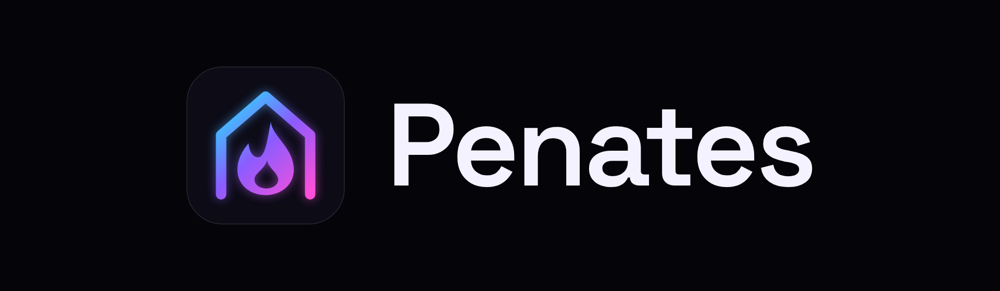
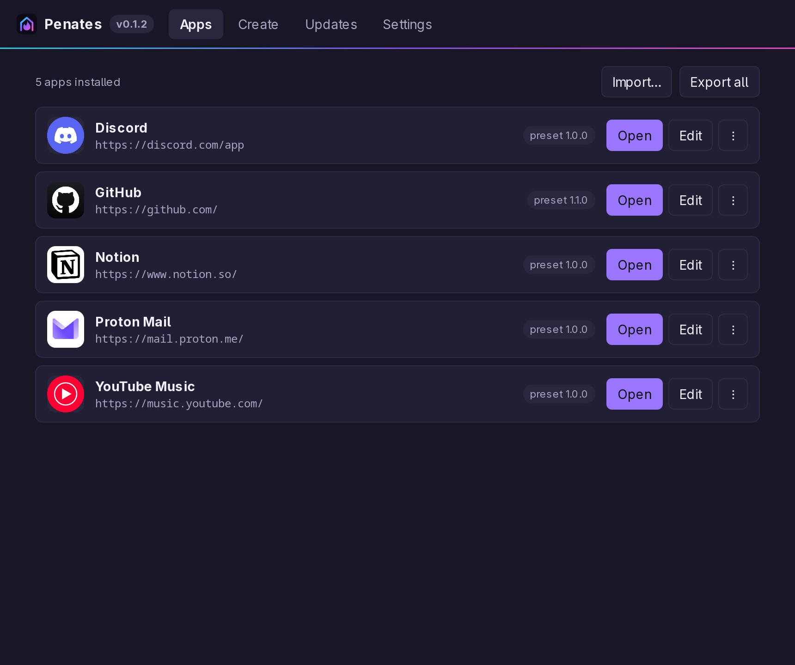
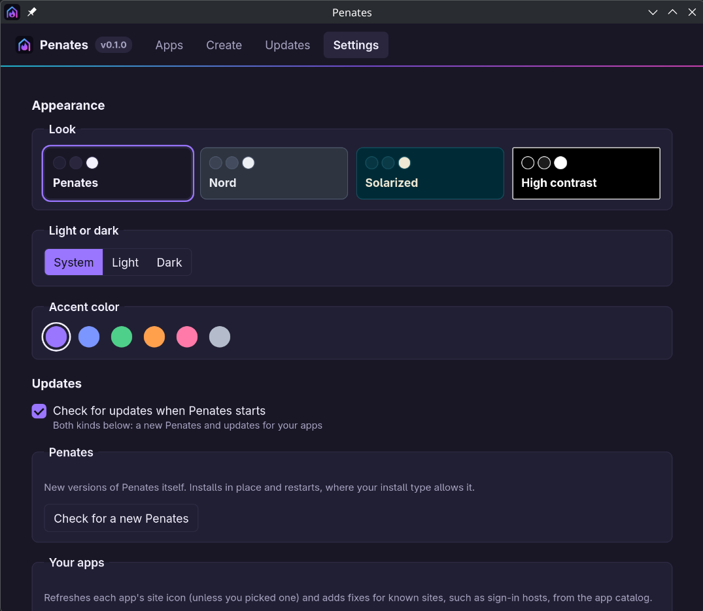
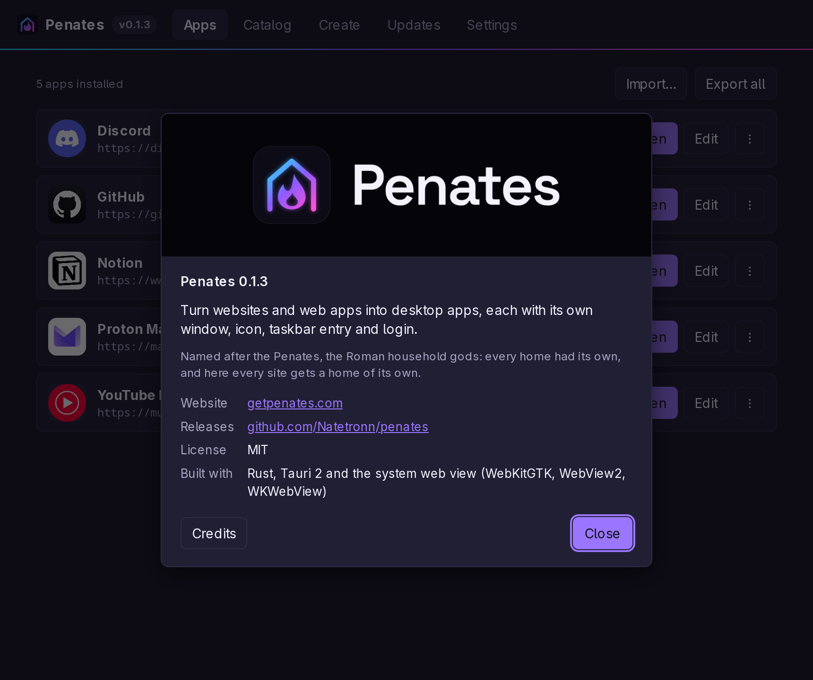

<p align="center"></p>

Turn any website or web app into a desktop app with its own window, icon, taskbar entry, tray icon and
separate login. Named after the Roman household gods: every site gets a home of its own.
Built with Rust and [Tauri 2](https://v2.tauri.app/), with a command line tool and a desktop manager.

**[Download the latest release](https://github.com/Natetronn/penates/releases/latest)**:
AppImage, .deb, .rpm, Windows installer, macOS .dmg, or `paru -S penates-bin` on Arch.

<p align="center"></p>

> **Status: 0.1.0.** Verified by hand on Linux (KDE Plasma, Wayland). Windows and macOS are built, launched
> through their launchers and smoke-tested in CI on every push. See [docs/STATUS.md](docs/STATUS.md) for exactly what is verified.

## What it does
- **One command or a few clicks:** `penates create github.com` finds the site's name and icon (PWA manifest, apple-touch, favicon) and adds it to your application menu.
- **A real app window per site:** own taskbar entry and icon, separate cookies and storage per app, single-window mode, optional system tray icon (color or grayscale).
- **Per-app options:** window size, zoom, maximized/fullscreen/frameless, always on top, user agent, extra in-app hosts, custom CSS/JS, devtools.
- **Smart links:** links to other sites open in your browser; same-site popups (sign-in flows) stay in the app; downloads go to your Downloads folder.
- **Share and back up:** export one app or all of them to a `.penates` file and import it elsewhere; logins are never included. See [docs/SHARING.md](docs/SHARING.md).
- **Housekeeping:** clear cache (keeps you signed in) or clear cookies and data, update checks with versioned presets, icons from a file or URL.
- **Themeable manager:** light/dark/system, six accents, four looks, all from plain CSS tokens.

## Screenshots
| Your apps (light) | Edit an app |
|---|---|
|  |  |
| **Settings** | **About** |
|  |  |

## Install
Get an installer from the [releases page](https://github.com/Natetronn/penates/releases/latest), or build from source
(Arch/CachyOS shown; see [docs/PACKAGING.md](docs/PACKAGING.md) for `.deb`, `.rpm`, AppImage and tarball):

```sh
sudo pacman -S --needed rustup webkit2gtk-4.1 libayatana-appindicator
rustup default stable
git clone <this repo> && cd penates
cd packaging/arch && makepkg -si        # installs penates + penates-desktop
```

Or just run it from the checkout: `cargo build --workspace`, then `target/debug/penates gui`.

## Quick start
```sh
penates create github.com            # name + icon found automatically
penates create https://mail.proton.me --name "Proton Mail" --icon https://example.com/logo.png
penates list
penates run github
penates gui                          # the manager window
penates check && penates update --all # preset + icon updates
penates clear github                 # clear cache; add --data to sign out too
```
Full reference: [docs/CLI.md](docs/CLI.md).

## Layout
| Path | What |
|---|---|
| `crates/penates-core` | shared logic: config store, icons, site names, launchers, updates, single-instance |
| `crates/penates-cli` | the `penates` command |
| `src-tauri` | `penates-desktop`: the manager window and the per-app runner (Tauri 2) |
| `ui` | manager front end (plain HTML/JS, `tokens.css`, `skins.css`; no build step) |
| `packaging`, `scripts` | Arch PKGBUILD, desktop file, package and tarball scripts |
| `docs` | architecture, configuration, theming, updates, packaging, status |

## Docs
[Architecture](docs/ARCHITECTURE.md) · [CLI](docs/CLI.md) · [Configuration](docs/CONFIGURATION.md) · [Theming](docs/THEMING.md) · [Updates](docs/UPDATES.md) · [Sharing](docs/SHARING.md) · [Packaging](docs/PACKAGING.md) · [Releasing](docs/RELEASING.md) · [Status](docs/STATUS.md) · [Changelog](CHANGELOG.md)

## License
MIT. See [LICENSE](LICENSE).
